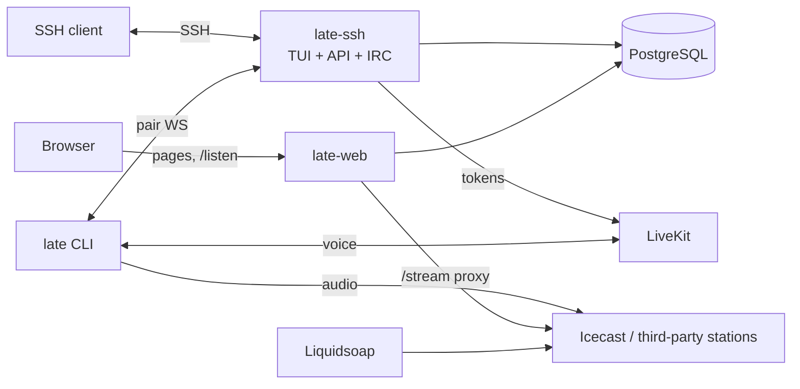

# late.sh

A cozy command-line clubhouse for computer people: chat, music, games, art,
news and profiles over SSH. `ssh late.sh` and you are in.

This file is the map. It says what the project is, where each domain lives,
the rules that cross domains, and how to build and test. Detail lives in the
`CONTEXT.md` next to the code it describes; read the matching one before
changing a domain.

## 1. Keeping the docs honest

- A context file says what is true now. No `Last updated` line, no dated
  entries, no "used to", "no longer", "since <date>": git log says when. The
  one running log is the incident log in `infra/RUNBOOK.md`.
- Ideas, roadmaps and parked designs go to a design doc (`SCALE.md`,
  `AUDIENCE.md`, `devdocs/`, a domain's own design file such as
  `deadchannel/GAME.md`), never to a context file. An open gap is a fact ("X does not do Y").
- A change that makes a doc wrong updates it in the same change. Update the
  local context for behavior inside a domain; update this file when a page,
  a domain, a cross-domain rule or a command changes. If code and a doc
  disagree, trust the code and fix the doc.
- A feature, key or screen change also updates
  `late-ssh/src/app/help_modal/data.rs` (it feeds the `?` guide and the bots'
  app context) and the splash tips in `late-ssh/assets/splash_tips/`.
- Keep this file under 500 lines. Past that, move detail into a seed doc next
  to the code and link it.

## 2. Workspace

| Crate | What it is | Context |
|-------|-----------|---------|
| `late-ssh` | SSH server (russh, port 2222), the TUI, HTTP API (4000), embedded IRC (6667 dev, 6697 TLS prod) | `late-ssh/CONTEXT.md` |
| `late-core` | Models, migrations, DB pool, shared helpers | `late-core/CONTEXT.md` |
| `late-web` | Web pages (axum, port 3000): landing, `/listen`, gallery, profiles, The Late Edition (`/paper`, with RSS), `/stream` proxy, `/live` | `late-web/CONTEXT.md` |
| `late-cli` | The `late` companion: launches SSH, plays audio locally, pairs over WS, voice | `late-cli/CONTEXT.md` |
| `late-webview` | The CLI's YouTube helper process (keeps WebKitGTK out of `late`) | `late-webview/CONTEXT.md` |
| `late-{nethack,dcss,brogue,usurper,dopewars,bashquest,codekeep,zork}` | Standalone door hosts, one pod each | the door's context under `late-ssh/src/app/door/` |
| `infra/` | Terraform for the RKE2 cluster, Liquidsoap/Icecast config | `infra/README.md`, `infra/RUNBOOK.md` |

Backing services: PostgreSQL (CloudNativePG), Icecast + Liquidsoap (house
radio), LiveKit (voice and streams), the OTLP collector with
VictoriaMetrics/Logs/Traces and Grafana (`monitoring/`).

Highest-risk areas: the SSH render loop under backpressure, connection
admission, chat sync consistency, pair-WS routing and state drift.

## 3. Rules that cross domains

### Sync render, async services

Rendering and the tick never do I/O: services own the DB and publish `watch`
snapshots and `broadcast` events; UI state drains them on tick and the UI
draws from local memory. The render loop, its dirty contract ("prove clean,
never prove dirty") and terminal output rules are in `late-ssh/CONTEXT.md`.

### The multi-replica rule

late.sh runs one SSH replica and is built as if several were already running
behind sticky sessions:

- **Truth lives in Postgres.** No process-global source of truth: no
  `Arc<Mutex<..>>` registry, `AtomicBool` switch, or per-process counter or
  daily cap another replica cannot see. A per-session mirror of DB state is a
  cache and fine.
- **Once-only actions are claimed in the DB.** Anything that must happen once
  per user or per world (a DM, a payout, a paid API call) wins a conditional
  `UPDATE ... WHERE <not yet> RETURNING` or a `pg_advisory_xact_lock` first and
  acts only on the win. Copy `User::claim_first_contact_invitation`,
  `Pot::lock_open`, `GamePayout::grant_multi`.
- **Cross-session fan-out goes through `LISTEN/NOTIFY`.** One LISTEN
  connection per process (`late-ssh/src/pg_listener.rs`): add the channel to
  its closed `Channel` enum, subscribe it in `main.rs`, run
  `start_notify_worker` over the queue. The worker gets `Signal::Resync` once
  the LISTEN is live (re-read there: it is the seed and the reconnect
  catch-up) and `Signal::Notify` per notify, and re-reads into a
  process-shared `watch`. Never open a domain-owned LISTEN connection. Copy news
  and daily matches (re-read only), the pot (payload applied in order),
  shop (several channels). Payloads carry ids, never state.
- **Background work dedupes through the DB**: claim a row first, or be
  idempotent and cheap enough to run on every replica.
- **Switches and fuses are rows**, never memory.
- **Presence goes through `app/presence`** (`late-ssh/CONTEXT.md`): rooms add
  a part to the per-session record, never a local registry. `active_users` and
  `SessionRegistry` stay local by design; add nothing to them.

Replica-ready, not over-engineered: one user's sessions on two replicas need
not sync live; a list that refreshes when its page opens is replica-ready;
only surfaces people sit and watch while others change them (News, chat, the
pot) get a NOTIFY-fed shared `watch`. Pick the cheapest correct
shape: read on open, then a notify, then anything more.

**Per-user state** (the bonsai, the pet, the tank, per-account settings)
follows one shape, worked in `late-ssh/src/app/bonsai/CONTEXT.md`: a pure
`state.rs`, one writer in `svc.rs` that locks the row, applies one rule,
stores it and notifies with the owner's id in one transaction, and a
`session.rs` render mirror that never decides or writes. It is for low-write
state; high-frequency shared surfaces (Artboard, house tables) need their own.

A design that cannot meet the rule says so in its local context and adds a row
to the ledger in `SCALE.md`, Pain Point 2, which also holds the rework plan.

### Security and scoping

- Every query over user-owned data filters by `user_id` in SQL
  (`user_scoped_model!`, `_by_user` methods). SQL lives in `late-core` models.
- Connection admission (per-IP rate limit, per-IP count, global permit) runs
  before the SSH handshake; the client IP comes from PROXY protocol behind the
  edge. Only public-key auth is accepted.
- Chat rooms are visible through membership only (`ChatRoom::list_for_user`).
  DM rooms canonicalize the pair (`dm_user_a < dm_user_b`) and keep durable
  endpoints. `#announcements` is admin-post-only, enforced in the send path.
  Message deletes are hard deletes.
- A server-side fetch of a user-supplied URL connects to public addresses only,
  by the one rule in `late-ssh/src/app/common/public_net.rs` (Files' downloader
  or the News reader's `PublicOnlyResolver`; never a new address list).
- IRC tokens and similar secrets are stored hashed; plaintext is shown once.

### Data

UUID v7 ids, `ON DELETE CASCADE` everywhere, forward-only migrations, change
notices in triggers. Rules and shared tables: `late-core/CONTEXT.md`.

### Chips

Every chip movement is a `ChipMove` variant written through
`UserChips::apply` with a `source_ref`; repeatable game prizes go through
`GamePayout::grant_multi`. `late-core/CONTEXT.md` has the ledger rules,
`app/leaderboard/CONTEXT.md` what counts on Top Chips,
`app/door/ingest/CONTEXT.md` the door milestone prizes, `app/hub/CONTEXT.md` the quest amounts, `app/hub/shop/CONTEXT.md`
the Shop prices, and each mechanic's own context its numbers (gilds, the
round, the pot, invites).

## 4. Pages

| Key | Page | Lives in |
|-----|------|----------|
| `0` | Clubhouse, the walkable tavern; the default landing page. `0` again goes down to the undercity (runners only) | `app/clubhouse`, `app/deadchannel` |
| `1` | Home: room rail, chat center (rooms plus News, Mentions, RSS, Voice, Discover), the live strip on #lounge, the right sidebar | `app/chat`, `app/live`, `late-ssh/CONTEXT.md` (sidebar) |
| `2` | The Arcade: solo games, daily puzzles, the quest strip | `app/arcade`, `app/hub` |
| `3` | Games hub: door games, servers, live games to watch | `app/door` |
| `4` | Artboard: the shared ASCII canvas and its gallery | `app/artboard` |
| `5` | People: map, profiles, jobs | `app/directory`, `app/usermap`, `app/jobs` |
| `6` | Leaderboards | `app/leaderboard` |
| `7` | Calendars: the events board | `app/calendar` |

`Tab`/`Shift+Tab` cycle the numbered pages. `users.settings.landing_page`
picks Clubhouse, Home or Zen for returning sessions; a session with the tour
still to walk always lands in the Clubhouse, and one a drain handoff moved
off an updating pod lands on the page it left (`handoff`).

Not in the cycle: the door screens (from the hub), the daily match board and
house tables (from the Lobby), the Realm board, the paired Scratchpad, the
Nightcap (behind the Clubhouse) and the undercity street. Overlays: Settings
`Ctrl+O`, Lobby `Ctrl+G`, Zen `Ctrl+F`, Shop `Ctrl+S`, the guide `?`, the
bonsai `w`, the profile modal, The Late Edition `/paper`. Global keys and the
keybinding change checklist: `late-ssh/CONTEXT.md`.

## 5. Domains

Each row is a `CONTEXT.md` under `late-ssh/src/app/` unless the path says
otherwise.

| Context | Covers |
|---------|--------|
| `late-ssh/CONTEXT.md` | Session shell: SSH lifecycle, render loop, terminal output, pair WS, per-device settings, config, activity feed, notifications, presence, sidebar, global keys |
| `late-core/CONTEXT.md` | Model rules, migrations, users and keys, the chip ledger, test DB helpers |
| `late-web/CONTEXT.md` | Web routes, templates, `/listen`, stream proxy, gallery and profile pages |
| `late-cli/CONTEXT.md` | The `late` binary: SSH modes, token handshake, audio pipeline, voice (the pair protocol in `PAIRING.md`, installers in `DISTRIBUTION.md`, terminal video in `VIDEO.md`) |
| `late-webview/CONTEXT.md` | The YouTube helper process: lifecycle, mute/volume, troubleshooting, the Linux spectrum capture |
| `late-ssh/src/ircd/CONTEXT.md` | Embedded IRC server: token auth, room/DM projection, IRCv3 caps, history, moderation |
| `DESIGN_GUIDE.md` | TUI conventions: layout, spacing, text roles, palette, modals, forms, hit geometry |
| `chat` | Rooms, DMs, composer, message actions, Showcase/Work feeds; the composer, every slash command and key in `COMMANDS.md`, rendering in `RENDERING.md`, read marks in `MARKS.md`, room data and the rail in `ROOMS.md` |
| `ai` | The model calls: ghost bots (@bot, @graybeard, @bartender), the round (`ROUND.md`) and bartender memory (`MEMORY.md`), text screening, translation, `/summary` |
| `chat/gild` | Gilds: chips paid to mark another user's message |
| `chat/news` | Shared links, the News room, the reader, where a story's watch position is kept |
| `chat/cyberspace` | The cyberspace.online client and its rail entry |
| `video` | The watch player: a News story or a chat YouTube link played in the terminal by the paired CLI's mpv, the setup box, the session's one play on the CLI |
| `audio` | Radio, YouTube queue and booth, source selection, `/listen` snapshot; the queue service in `QUEUE.md`, the equalizer in `VIZ.md`, the sidebar stage in `STAGE.md`, the stations in `STATIONS.md` |
| `voice` | LiveKit voice rooms, TUI voice controls, pair-WS voice messages |
| `stream` | `/golive` and `/watch` streams, the stream registry, the late-web live pages (staff and streamer tools in `MODERATION.md`) |
| `live` | The live strip (`now`) on #lounge and the Live panel (rows and keys in `PANEL.md`) |
| `paper` | The Late Edition: the daily paper and its print sweeper |
| `jobs` | The job feed: nightly press, posts, tags, matches |
| `herald` | The herald: one picture a day on the Fediverse and Bluesky, the daily claim and the post |
| `usermap` | The People map |
| `directory` | The People page and the profile editor |
| `profile_modal` | The read-only profile modal and the chips ledger |
| `settings_modal` | Settings (`Ctrl+O`): tabs, pickers, mouse, save rules |
| `handoff` | Drain handoff: a quiet native-CLI session moved off an updating pod onto its page, the "Auto restart on update" tweak |
| `statusline` | The frame status bars and their customizer |
| `zen` | Zen (`Ctrl+F`): the tiling layout, the pet and tank tiles |
| `ascii` | The animated ascii pieces, the Zen ascii tile, the away screensaver |
| `bonsai` | The bonsai: branch graph, care modal, daily chips; the per-user state reference |
| `hub` | The Shop (`Ctrl+S`), quests, pet unlock (the marketplace, rentals and flair in `shop/CONTEXT.md`, the reef in `aquarium/CONTEXT.md`) |
| `games` | Shared game primitives: cards, the chips service, `chess_core`, `pool_core` (each kernel has its own `CONTEXT.md`) |
| `arcade` | The Arcade: solo games, daily puzzles, high scores (per-game notes, controls and adding a game in `GAMES.md`) |
| `leaderboard` | Leaderboards page, board rosters, the refresh service (monthly awards and milestone badges in `AWARDS.md`) |
| `lobby` | The `Ctrl+G` Lobby modal |
| `lobby/daily` | Daily correspondence games: roster, matches, boards, deadlines (per-game rules and adding a game in `GAMES.md`, surfaces in `UI.md`, pool in `POOL.md`) |
| `lobby/house` | House tables: poker, blackjack, Asterion, Tron, Super Snake |
| `workspace` | The backtick cycle across live games |
| `pot` | The weekly pot |
| `referral` | Invites and their payouts |
| `calendar` | The events board |
| `clubhouse` | The tavern: crowd, seating, bubbles, the tour, the floor plan |
| `clubhouse/nightcap` | The Nightcap bar out back |
| `scratchpad` | `/pair` shared scratchpad |
| `deadchannel` | The character game: the map of its slices, persistence; design in `GAME.md`; the diagnosis it rests on in the root `AUDIENCE.md`, the #lounge valve it waits on in `devdocs/FEED-BUDGET.md` |
| `deadchannel/runner` | The runner: the look, the directory, the face in #deadchannel, the runner row |
| `deadchannel/haunt` | First contact: the haunting ladder that brings staff in, `/haunt` |
| `deadchannel/city` | The night city under `0`: map, shops, panels, art |
| `deadchannel/fight` | The day's road, the cards, the round, the crossing; money, crystals and balance in `fight/*.md` |
| `deadchannel/lounge` | The #lounge spawns |
| `door` | The Games hub and the door family; each door has its own context below it |
| `door/lateania` | Lateania, the shared world RPG (the lands and content in `WORLD.md`, combat and items in `COMBAT.md`, keys and panels in `UI.md`, land numbers and the balance audit in `PROGRESSION.md`, the maps in `WORLDMAP.md`) |
| `door/realm` | The Realm, the standing conquest world (rules and payouts in `RULES.md`, Earth and drawn worlds in `MAPS.md`, screens in `UI.md`) |
| `door/greendragon`, `door/darkroom` | Native remakes (LoGD-style RPG with its systems in `MECHANICS.md` and support digest in `PLAYERS.md`; A Dark Room, its scope, endings and battleship in `GAME.md`) |
| `door/nethack`, `door/dcss`, `door/brogue`, `door/usurper`, `door/dopewars`, `door/bashquest`, `door/codekeep`, `door/zork` | PTY doors and their host crates (build and deploy in `DEPLOY.md` for NetHack, DCSS, Brogue, dopewars and BashQuest; DCSS's public crawl files in `dcss/PUBLISH.md`, Brogue's grid fixes in `brogue/RENDER.md`, BashQuest's graduation pipeline in `bashquest/CERTIFICATE.md`) |
| `door/spectate` | Watching live door games |
| `door/ingest` | The door log pipe: host log files into `door_runs`/`door_milestones`, door badges and payouts |
| `door/minecraft`, `door/vintagestory` | Info-only cards for the game servers, and the servers' operations (every Vintage Story world option in `vintagestory/WORLDCONFIG.md`) |

No context of its own (read `late-ssh/CONTEXT.md` and the code): `activity`,
`common`, `dashboard`, `files`, `help_modal`,
`icon_picker`, `notify`, `pet`, `presence`, `profile`, `ultimates` and the
small modals.

## 6. Other docs

- `SCALE.md`: capacity, measured costs, the multi-replica ledger and the
  scaling plan, small debts.
- `AUDIENCE.md`: who comes and what they do, measured: where attention goes,
  what the numbers say, the ideas that follow, and how to query it.
- `infra/README.md`: cluster setup, nodes, game servers, Terraform variables.
  `infra/RUNBOOK.md`: prod DB access, triage, deploys, the incident log.
- `MUSIC.md`: the house music library and its licenses (linked from `/listen`).
- `THEME.md`: adding a theme. `CONTRIBUTING.md`, `LICENSING.md`: for
  contributors.
- `devdocs/`: research and design notes (door candidates, the parked feed
  budget, the IRC design and IRCv3 ideas, the parked audio leader, the CLI
  YouTube backend plan, the permissions matrix).

## 7. Telemetry

OTLP traces, logs and metrics through the collector into VictoriaMetrics,
VictoriaLogs and VictoriaTraces; Grafana dashboards are provisioned from
`monitoring/`. Metrics are typed `record_*` functions in each crate's
`metrics.rs`, with a no-op twin when built without the `otel` feature; labels
come from closed enums. Logs, metrics and spans belong to the orchestration
layer (services, the render loop), never to state or UI code. Dashboard and
query gotchas: `infra/RUNBOOK.md`.

## 8. Build, run, test

- `mise install` sets up `rust`, `mold` and `cargo-nextest` (`.mise.toml`).
- `make start` runs the stack in Docker Compose (it copies `.env.dev` to
  `.env`; personal keys go in the gitignored `.env.local`; `make
  start-instance2` runs a second instance from `.env.dev2`). Connect with `ssh
  localhost -p 2222`. The dev profiles pin compose hostnames, so the apps run
  only inside compose. Config is compiled per profile (`late-ssh/CONTEXT.md`,
  Config).
- late-ssh runs locally the way prod runs it: pods behind a local copy of the
  prod SSH edge (`docker-compose.yml` `service-ssh` and `ssh-pod`,
  `scripts/fleet.sh`). `make start` builds the working tree as a generation,
  then watches `late-ssh`, `late-core`, `assets` and the Cargo files: a
  change that rebuilds the binary rolls out a new generation as a deploy
  does, the new pod ready and routed by the edge before the old one gets
  SIGTERM and drains, and a build, start or edge pickup that fails leaves the
  old pod serving. An open session stays on the old code behind the update
  banner until you reconnect, or until the native CLI moves it after 30 s
  without input (`late-ssh/src/app/handoff/CONTEXT.md`). From another
  terminal, `make fleet-rollout` rolls out even an unchanged binary, and
  `make fleet-ps`, `fleet-logs` and `fleet-expire` (the 6 h grace deadline)
  work the pods; `make stop` and `make down` refuse while a `make start`
  runs, whose Ctrl-C stops the stack. `REPLICAS=2` reproduces the pair websocket misrouting in
  `SCALE.md`, Pain Point 2.
- Fixtures: `make seed-artboard`, `seed-calendar`, `seed-paper`,
  `seed-irc-history`, `seed-leaderboard`, each described in its domain's
  context. Chips for a local account come from the admin `/grant` command.
- **Agents run targeted tests only:** `make test-llm ARGS="-p <crate> --lib -E
  'test(<filter>)'"` starts the check DB and runs nextest in a low-priority
  scope capped to the memory free at launch (it refuses to start when too
  little is). It builds incrementally, so a rerun after a small edit takes
  about 25s; keep the `-p` set the same between runs, since a new set
  rebuilds `late-ssh` cold. `--lib` is for a crate with both a lib and a main
  (`late-ssh`, `late-web`, `late-core`, `late-webview`): without it the lib
  compiles twice.
  A main-only crate (`late-cli`, the game doors) drops it. Never raw `cargo test`, `cargo nextest` or `cargo clippy`, and never a
  full suite. `cargo check`, `cargo build` and `cargo fmt` are fine.
- **`make check` is the human gate:** `cargo fmt --check` on first-party
  packages only (never `cargo fmt --all`, which would reformat vendored crates),
  then clippy over the workspace with `--features otel` (the only place the
  otel build is compiled) and nextest over the workspace without it. Like
  `test-llm` it builds incrementally, so a rerun after a fix is mostly warm.
  It runs its own Postgres from
  `docker-compose.check.yml` (`late-check`, port 55433), never the app's.
- Tests live next to the code they test (`foo_test.rs` beside `foo.rs`, or a
  small inline `mod tests`); no crate has a `tests/` directory. Harnesses:
  `late-ssh/CONTEXT.md` (Tests), `late-core/CONTEXT.md` (Tests).
- Infra PRs run credential-free `terraform fmt`/`validate`; the live plan runs
  for same-repository PRs only.
- `mod.rs` files hold module declarations only, never `pub use`.
