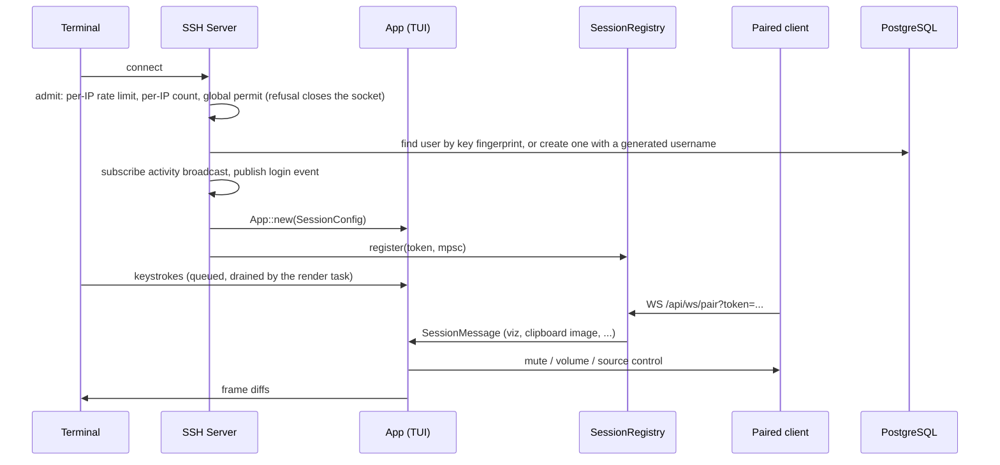
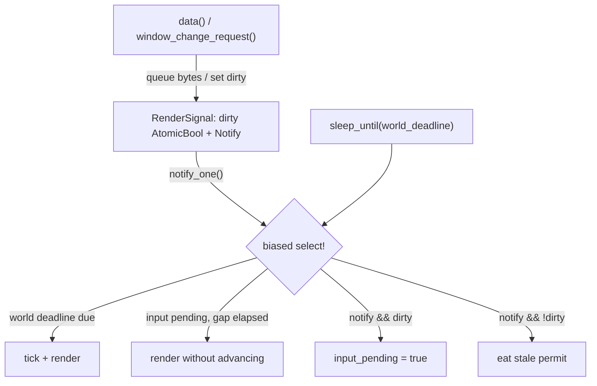

# late-ssh: the session shell

Everything in `late-ssh/src` that is not a domain with its own `CONTEXT.md`:
the SSH server and its render loop, the HTTP API and pair WebSocket, the
compiled config, the root glue (`app/{state,input,tick,render}.rs`), terminal
output, and the small shared pieces with no context of their own (activity,
notify, presence, the help modal, the ghost bots, the sidebar). Root
`CONTEXT.md` routes to every domain.

## 1. File map

```text
late-ssh/src/
  main.rs              starts SSH + API + background loops; subscribes LISTEN channels
  ssh.rs               russh server: admission, auth, the per-session render task
  session_bootstrap.rs per-session service wiring at login
  api.rs               /api/* routes and /api/ws/pair
  session.rs           SessionRegistry: token -> mpsc (WS -> session, inbound)
  paired_clients.rs    PairedClientRegistry: token -> WS sender + client state (outbound)
  pg_listener.rs       the one LISTEN connection per process (closed `Channel` enum)
  config.rs            compiled dev/dev2/prod profiles
  state.rs             process-shared State: active_users, conn_counts, directories
  terminal_probe.rs    DSR round-trip probe; terminal_size.rs: resize clamp (500x200)
  render_signal.rs     dirty flag + Notify; proxy_protocol.rs; usernames.rs; authz.rs
  metrics.rs           typed record_* functions (otel feature, no-op twin without)
  moderation/          /mod commands and their session effects
  ircd/                embedded IRC server (own CONTEXT.md)
  dartboard.rs         Artboard server wrapper (see app/artboard/CONTEXT.md)
  test_helpers.rs      shared app-level test harness (#[cfg(test)])
  app/
    state.rs input.rs tick.rs render.rs   root glue: hold domain state, delegate
    terminal_backend.rs                   GlyphIsolatingBackend
    activity/ notify/ presence/ help_modal/ ai/ common/ pet/ profile/ crown/ ...
```

Root glue rule: a root file holds a domain's state and delegates to it. The
moves still owed out of the four root files are listed in `SCALE.md`, Small
Debts, "Root-file thinning".

## 2. Session lifecycle



- Admission runs before the SSH handshake (`Server::admit`): any refusal
  returns before `run_stream`, so a flood holds no permit, task or buffer.
  `late_ssh_connections_rejected_total{reason}` counts refusals.
- Only public-key auth is accepted. The pre-auth banner points plain `ssh`
  users at the CLI installer; native `late-cli` suppresses it.
- The SSH login name is ignored except `invite-<code>` on the connect that
  creates an account (`app/referral`). New accounts get a generated username
  (`usernames::next_generated_username`), retried on a unique violation.
- The activity receiver is created in `auth_publickey`, stored on
  `ClientHandler`, and taken into `SessionConfig` in `pty_request`. The login
  event is published in `pty_request`, the first point that knows whether
  the session's CLI moved it here, off a draining pod or on a quit-modal
  restart (`LATE_RESUME`); a moved session publishes none. Creating the receiver after the publish misses the user's
  own login event.
- `force_admin` is a profile literal (`true` in dev, `false` in prod), OR'd with
  `users.is_admin` at session init.
- SSH compression is pinned to `NONE`: a client that negotiates zlib drops
  mid-session on the first keystroke that moves a character.
- A draining pod (shutdown signal, `is_draining`) keeps its sessions behind
  the "Server updating!" banner, except a quiet native-mode CLI session: it
  is asked to redial the new pod and sends back `LATE_RESUME` (read in
  `env_request` into `SessionConfig::resume`), which lands it on the page it
  left. Flow, rules and gaps: `app/handoff/CONTEXT.md`.

## 3. Sync/async boundary

Rendering and the tick never await. Services (`svc.rs`) own the DB pool and
spawn tasks; they publish `watch` snapshots and `broadcast` events. UI states
(`state.rs`) subscribe at `App::new`, drain their channels in `tick()`, and
render reads local memory only. An input that needs I/O calls a
fire-and-forget service method; the result arrives on a later tick. Per-user
background tasks spawned at session init are aborted on `Drop`. Targeted events
carry a `user_id` and are filtered in UI state.

## 4. Render loop

Each session spawns one render task (`ssh.rs`) with two triggers:

- **Adaptive world tick.** Each pass returns `App::wake_hint()` and the loop
  sleeps that long unless input or a `RenderSignal` wake lands first. Tiers
  (`app/tick.rs`): `HOT_TICK` 66 ms (splash, 2 s after any input, an active
  ultimate, house tables, an open arcade game); `ANIM_HALF_TICK` 132 ms (the
  Clubhouse, a visible right sidebar, a Zen music/visualizer tile, the live
  strip while it draws, the bonsai modal and a profile showing a tree, the pet
  box, ascii pieces in dots); `ANIM_QUARTER_TICK` 264 ms (aquarium surfaces,
  ascii pieces in pixels); `IDLE_TICK` 500 ms otherwise. The away screensaver
  returns its tier ahead of every other check. Floor ticks only drain channels.
- **Input-driven render.** Within `MIN_RENDER_GAP` (15 ms) of a keystroke or
  resize, a render that does not advance world time. Door proxies push-wake
  the same path for remote output.

Keystrokes land in a bounded per-session queue (`INPUT_QUEUE_CAP` 256, input
dropped with a warning when full) that the render task drains into
`App::handle_input()` right before each pass, so ordinary input never takes
the app mutex. Bursts of `input queue full` in prod are paste bombs, not lost
typing. One pass hands over at most `INPUT_DRAIN_MAX_MESSAGES` (64) messages
and stops early once `INPUT_DRAIN_MAX_TIME` (4 ms) of handling is spent, then
draws and re-arms itself for the rest (`drain_input`). The time budget is
checked between messages, so one slow message (a big paste) can run past it;
a key flood costs its own session a frame of lag instead of holding the tokio
worker for the whole queue.

**Slow passes.** `late_ssh_render_pass_seconds{reason,screen}` times the
locked part of every pass (input drain, tick, draw). A pass longer than
`HOT_TICK` logs `slow render pass` with the username and screen, at most once
a minute per session, so `_msg:"slow render pass"` in VictoriaLogs names who
is pinning a worker while the fleet's CPU average still looks green.

**Wall clock, not counters.** `marquee_tick` is derived from elapsed wall time,
and every frame edge compares its period index against the previous tick's
(`self.marquee_tick / N != prev / N`). `is_multiple_of` on the counter is a bug
pattern under sparse ticking, as is any per-tick accumulator.

**Dirty gate.** `App::tick()` returns whether anything shown changed;
`render_once` ORs it with the `RenderSignal` dirty flag and drained input, and
a clean pass skips `terminal.draw()` (ratatui's diff state does not advance, so
resume needs no repaint). Every domain `tick() -> bool` answers "did anything
this session shows change?" with exactly three sources of `true`:

1. Channel-fed state reports its drain: peek before draining (`has_changed()`,
   `!is_empty()`) or compare before assigning. A watch only `borrow()`ed at
   render must be marked seen (`borrow_and_update`) or the peek latches dirty.
2. Animations report their frame boundary, only while visible. Shared
   time-driven truth (a server game loop, the blackjack dealer) lives in the
   service as snapshots and reaches the session through rule 1.
3. Anything uncertain reports changed. Prove clean, never prove dirty: a
   spurious frame costs bytes, a wrong "clean" freezes the UI.

A blanket `changed = true` or fixed cadence needs a written justification at
its call site; the survivors are in `tick.rs` (splash typing, the lobby
modal's 1 Hz occupancy, the daily board's 1 Hz deadline clock, the shared
`anim_half` and `anim_quarter` edges, the 1 Hz edge for slow ascii pieces).



- `biased` ordering lets the world deadline win ties, so a keystroke flood
  cannot starve animation. `next_render_action` is a standalone fn so the
  decision is unit-testable.
- `dirty` and `Notify` are separate on purpose: `notify_one()` stores one
  permit when nobody waits, so `Notify` alone would fire a duplicate frame for
  input an earlier render already covered. The input path sets `dirty` after
  enqueueing; the render task clears it right before draining. Pinned by
  `stale_permit_does_not_arm_throttle`.
- The world deadline is re-armed from now after each pass, so a slow frame
  skips ahead instead of queueing catch-up ticks. An input render can pull the
  deadline closer but never pushes it out.
- Throttle is per session: ceiling about 67 renders/s.
- **Output budget.** `OutputBudget` counts bytes handed to russh against window
  credit returned in `Handler::window_adjusted`. Over 32 MB outstanding the loop
  stops rendering (russh otherwise queues window-exhausted writes without
  bound); 30 s of sustained stall disconnects the session.
- `handle.data` has a 50 ms timeout; an `Err` (closed channel) ends the render
  task once instead of logging every tick.
- The app mutex is still held across `tick()` + `render()`; the input queue
  closed the cadence gap, not that stall (`SCALE.md`, Pain Point 1).

**Terminal round-trip probe** (`terminal_probe.rs`). Every 10 s, or as soon as
the last probe is 2 s old after a second with over 32 KiB written, the loop
follows a pass with `CSI 5 n`. The answer time is what a user waits for a
frame: `late_ssh_terminal_rtt_seconds{client,backlog}` and
`late_ssh_terminal_probes_total{client,outcome}`. One probe in flight; a lost
probe (30 s) waits a full interval; three losses retire probing for the
session. `data()` strips every whole `CSI 0 n` before the input queue (a reply
must never reach the `App`), so nothing else may send `CSI 5 n`. A quitting
session waits up to 500 ms for an in-flight answer. When the loop exits it logs
one `session wire summary` line (`log_wire_summary`). How to read it:
`SCALE.md`, Pain Point 11.

## 5. Terminal output

- **Side channels bypass the frame diff.** OSC 777 / OSC 9 notifications, OSC
  52 clipboard copies and Kitty/iTerm2/Sixel image data go to
  `App::pending_terminal_commands`; `render_once` sends each as its own
  `handle.data` after the frame diff. Writing them into the frame would re-emit
  them on every redraw.
- **Capability probes.** XTVERSION (`CSI > q`), iTerm2 `OSC 1337;Capabilities`
  and DA1 (`CSI c`, last, as a sync point) go out with the alt-screen setup; the
  input parser consumes the replies. Kitty-family wins over iTerm2-family wins
  over Sixel; DA1 attribute 4 only fills in Sixel when nothing else was found.
  `TERM` of tmux disables raster previews entirely (no passthrough).
- **Rasters.** Chat rows always render the RGB block fallback; native image
  data is fetched lazily for the image modal and opt-in producers (none today).
  Kitty ids live in `0x4C000000..0x4CFFFFFF` with a dedicated z-index; an image
  id is a fold of its pixels and `kitty_transmitted` records what the terminal
  holds, so a re-placement is an `a=p` of a few dozen bytes. iTerm2 and Sixel
  have no delete-by-id, so `pre_frame_persistent_raster_wipe_bytes` writes wipe
  spaces ahead of the frame on transitions (modal closed, image swapped,
  overlay opened, screen changed, protocol changed). A timed-out side-channel
  write calls `force_full_repaint` and abandons the batch.
- **Video never passes through the server:** the paired CLI's mpv draws to
  the user's tty; the server paints the player black and sends the CLI the
  rectangle (`app/video/CONTEXT.md`).
- **`GlyphIsolatingBackend`** (`app/terminal_backend.rs`): any cell that is not
  one ASCII byte gets an explicit cursor move after it (column-only after a
  single codepoint, full move after a multi-codepoint grapheme), and a wide cell
  is blanked before its glyph. This confines unicode-width versus terminal
  wcwidth disagreements to the glyph's own cells.
- **Ratatui 0.30.2 / ratatui-widgets 0.3.2 / ratatui-textarea 0.9.2.** `App`
  must be `Send` for russh's handler bound; re-check on any bump.
  - Never call `Terminal::clear()` or `Terminal::resize()` on the SSH backend:
    both query the controlling tty and fail on our write-only sink.
    `App::force_full_repaint` emits the clear by hand and resets both buffers
    with `swap_buffers()`; `App::resize` rebuilds the terminal with
    `Viewport::Fixed` and repaints.
  - `App::set_screen` ends every screen change in `force_full_repaint`: a wide
    glyph half-overwritten by the next layout survives the diff otherwise.
- `Ctrl+R` (and `/redraw`) is the manual full repaint.

## 6. Input parsing

SSH input runs through a persistent `vte::Parser` (`app/input.rs`), so CSI/SS3
sequences and bracketed paste survive split reads. `is_likely_paste` treats a
large printable unmarked chunk as paste for terminals without bracketed paste.
A lone `Esc` resolves on a short tick delay so a split escape sequence is not
read as cancel; the splash ignores terminal replies the same way. The help
modal, when open, swallows the next key to close.

## 7. API and pair WebSocket

`late-ssh` HTTP API, port 4000:

- `GET /api/health`, `GET /api/status`, `GET /api/now-playing?mount=`,
  `GET /api/radio-meta`, `GET /api/listen` (public, memory-only snapshot behind
  late-web's `/listen` page).
- `/api/stream/*` capability routes for "watch me" streams
  (`app/stream/CONTEXT.md`).
- `GET /api/ws/pair?token=` upgrades the paired CLI and its webview helper.

Pair WS, client to server: `heartbeat`; `viz` (16 bands; older CLIs send 8 and
`bands_from_wire` stretches them); `client_state` (kind, ssh mode, platform,
mute, volume; legacy `browser`/`webview` spellings still parse); `latency`
(telemetry only, `late_ssh_cli_latency_seconds{kind,platform}`; deploy the
server before a CLI that sends a new event). Server to client: `toggle_mute`,
`volume_up`, `volume_down`, `reconnect` (a drain handoff or the quit modal's
`r restart`, only to a CLI that advertises the `reconnect` capability;
`app/handoff`), plus the audio-source,
clipboard, YouTube and voice messages owned by `app/audio`, `app/voice` and
`late-cli`.

Pairing flow:

1. The PTY request creates a session token and its `SessionRegistry` route.
2. The client connects to `/api/ws/pair`; the API registers an outbound slot in
   `PairedClientRegistry` (latest registration wins per token).
3. `client_state` updates the slot and persists mute/volume to this device's
   `user_ssh_keys.settings`; the session's first paired client only is aligned
   to the stored value, claimed per session token, so a mid-session reconnect
   never unmutes a muted session (`app/audio/CONTEXT.md`).
4. `m`, `+`, `-` go back over the same socket to that token's client only.
5. A client disconnect drops paired state; a silent viz source expires after
   750 ms and the eq falls back to the ambient band.

Hardening: 16 MB frame cap, 8 registrations per token, per-IP concurrent
pair-socket cap, bounded control channel (64, drop on full), clipboard images
accepted only against an outstanding request. A token the pod does not know
answers 404 (`late_ssh_ws_pair_rejected_unknown_token_total`).

## 8. Per-device settings

Some settings belong to the SSH key a session authenticated with
(`ClientHandler::auth_fingerprint`, not `users.fingerprint`), stored in
`user_ssh_keys.settings` and scoped by `user_id` as well:

- **The two Home rails** (room list, right sidebar). `App::rail_modes()` is the
  only resolver: this key's layout, else the account's. `\` cycles both / room
  list hidden / sidebar hidden / both hidden / `auto`; it and the two Settings
  Appearance rows write the key, never the account (the account value is only
  the seed for a key with none). The settings modal keeps them in
  `device_rails`, outside the draft `save()` writes, pinned by
  `unrelated_settings_edits_do_not_republish_this_device_rails`. `auto` resolves
  against the live width each frame (`AUTO_ROOM_LIST_MIN_COLS` 96,
  `AUTO_RIGHT_SIDEBAR_MIN_COLS` 72). The `show_*` bools are still written next
  to the `*_mode` strings for rollback safety.
- **The Artboard content disclaimer.** Same shape (`artboard_disclaimer` on the
  key, `App::artboard_disclaimer_enabled`), except a failed key read fails
  closed to on.
- **Mute and volume** (section 7, step 3).

Keyless sessions (ghost bots, tests) apply a change for the session only.

## 9. Config

`late-ssh/src/config.rs` and `late-web/src/config.rs` hold `dev`, `dev2` and
`prod` profiles as code, selected by `LATE_ENV` (missing or unknown is a startup
error). The only other env reads are secrets (DB, LiveKit, door secrets) and
dev opt-ins keyed on presence: `LATE_AI_API_KEY`, the R2 pair
`LATE_FILES_S3_ACCESS_KEY_ID`/`..._SECRET_ACCESS_KEY` (half set is an error),
`LATE_YOUTUBE_API_KEY`, the herald's pairs `LATE_HERALD_MASTODON_INSTANCE`/
`..._MASTODON_TOKEN` and `LATE_HERALD_BLUESKY_IDENTIFIER`/`..._BLUESKY_PASSWORD`
(half a pair is an error; prod pins both accounts and requires both secrets).
`Config::validate()` checks cross-field invariants at
boot. Tests in `config_test.rs`. Dev profiles pin compose hostnames, so the
apps only run inside `docker compose`. Shipping a config change that adds or
removes a required secret follows the deploy skew rule in `infra/RUNBOOK.md`.

## 10. Shared shell pieces

- **Activity** (`app/activity`). `ActivityEvent` (dedupe id, user, action,
  `ActivityKind`, category, time) on one broadcast. `activity/lounge.rs` is one
  process task that filters through `filter::lounge_includes` (the one
  exhaustive kind+game match deciding what reaches #lounge), throttles repeats
  per user and event shape for 30 minutes, and posts survivors as `system` user
  messages with the `· ` prefix. Its twin `lounge_headline` builds the
  un-prefixed headlines. The TUI diverts system lines into the composer-gap
  ticker (`app/chat/CONTEXT.md`), unread counts skip them, IRC sees plain
  PRIVMSGs. `ActivityCategory::Quest` events (scores, settled hands) feed
  `QuestService` and no public surface. Sessions keep a subscription only to
  edge-detect friend joins.
- **Notify** (`app/notify`). `Kind` (`Friends`, `Dms`, `Mentions`,
  `GameEvents`, `Streams`; `key()` matches `users.settings.notify_kinds`), every
  notification's copy, and the OSC 777 / OSC 9 bytes. Producers push through a
  cloned `Notifier`; `render.rs` drains `App::notify_outbox` once per frame,
  taking the first pending kind the user enabled (`Friends` always passes) and
  honouring `notify_cooldown_mins`. New accounts have every kind off. Adding a
  kind: a `Kind` variant and constructor, a settings row, a producer. tmux is
  unsupported (no DCS wrapping).
- **Presence** (`app/presence`, wire in `late-core/src/models/presence.rs`). One
  record per session (tavern seat, Nightcap stool, night-city runner, `lounge`
  flag), batched per replica onto the `presence` notify every 200 ms with a 3 s
  heartbeat, dropped 10 s after a replica goes quiet. A new room adds a part to
  the record, never a local registry. `late_ssh_presence_total{beat}`,
  `late_ssh_presence_records{scope}`.
- **Username directory.** `State.username_directory` is the app-wide
  `Uuid -> username` map: loaded at startup, refreshed every 30 minutes, updated
  on login, profile save, mod rename and account delete. Plain name labels read
  it; do not add per-feature username caches.
- **Online counts.** `State.active_users` (authenticated SSH and IRC sessions,
  ghost bots included) backs the sidebar's online count and
  `/api/now-playing.listeners_count`; it is app presence, not Icecast listener
  analytics. `State.conn_counts` is the per-IP connection count. Both are
  per-process by design (`SCALE.md`, Pain Point 2).
- **Away.** `app/common/away.rs`: 30 quiet minutes, `/brb`, or IRC `AWAY`, on the
  `active_users` roster, resolved once a second.
- **Ghost bots.** @bot, @graybeard, @bartender and @dealer are DB users with
  fixed fingerprints (`bot-fp-000`, ...), joined to public rooms and inserted
  into `active_users` at startup with `fingerprint: None` (which keeps them out
  of the Clubhouse seat pool). AI lives in `app/ai`: `bot_app_context()` feeds
  @bot the full guide, `bartender_app_context()` feeds @bartender navigation
  only, @graybeard gets neither.
- **Sidebar** (`app/common/sidebar.rs`). Pinned core rows (online count, clock,
  connected friends) then the user's panels (`RightSidebarComponent`) in their
  order, each a fixed height; `visible_components` stops at the first panel
  that does not fit, so panels drop from the bottom. Free space takes leftover
  rows. Pet and Tank are shop-gated and view only here. A panel missing from a
  stored list is backfilled at its default under its default predecessor
  (`normalize_right_sidebar_components`). Stored `"activity"` and `"pot"` keys
  are dropped on read. The Live panel is `app/live`.
- **Frame.** Status bars on both borders through `app/statusline`; the toast is
  a 3-row block top-center of the content area, under the settings overlay.
  The sponsor link `late.sh/thanks` redirects through late-web.
- **Help modal** (`app/help_modal`, `?` or `/guide`). One overlay, topics in
  `HelpTopic::ALL` (Pair first). `data.rs` also backs the bots' app context, so
  stale help misleads users and bots alike. Content invariants: the OSC 52
  support list per terminal, why there is no OSC 8, Shift+drag to select past
  mouse reporting, OSC 777/9 notification support (tmux needs
  `allow-passthrough`). Splash tips live in
  `late-ssh/assets/splash_tips/*.json`.

## 11. Global keys

Domain keys live in each domain's context. Left clicks on the frame's `0`-`7`
run before page input. App-wide modals keep input priority; keyboard-only
interaction mode ignores mouse reports.

| Key | Action |
|-----|--------|
| `0`-`7`, `Tab` / `Shift+Tab` | Pages; Tab cycles them (Clubhouse first) |
| `q`, `q` | Quit confirm, then exit; `Esc` dismisses |
| `?` | Global guide (not while composing; Artboard keeps its own help) |
| `Ctrl+O` | Settings, from anywhere but active Artboard editing |
| `Ctrl+G` | Lobby modal (daily games and house tables) |
| `Ctrl+F` | Zen over the current page, and back |
| `Ctrl+S` | Shop (active games and editors keep their own `Ctrl+S`) |
| `Ctrl+R` | Full repaint (redo inside the chat composer) |
| `m`, `+`/`=`, `-`/`_` | Paired client mute and volume |
| `w` | Bonsai care modal |
| `` ` `` | Workspace cycle (`app/workspace/CONTEXT.md`) |
| `\` | Cycle this device's rails (Home) |
| `/settings` `/lobby` `/zen` `/redraw` `/guide` `/picker` `/shop` | Composer fallbacks for chords a terminal swallows; each runs the key's function |
| `Esc` | Close the top modal |

`Ctrl+O/G/F/S` are ignored while a Settings text field is being edited.
`Ctrl+Q` and bare `g` are unbound on purpose.

Keybinding change checklist, every item:

1. The `match` in the relevant `input.rs` (`app/input.rs` for globals:
   `handle_reserved_global_chord`, `handle_global_key`).
2. `app/help_modal/data.rs` copy and `help_modal/ui.rs` footer; the Pair,
   terminal and economy topics in `terminal_faq.rs` / `hub_guide.rs`; the
   Keyhints copy in `app/statusline/bar.rs::shortcut_spans()`.
3. `app/settings_modal/ui.rs` footer and help callout.
4. Sidebar hints in `app/common/sidebar.rs`.
5. Per-game info panels that list controls.
6. The domain's `CONTEXT.md` key table (and this table for a global key).

## 12. Telemetry

Logging, metrics and spans belong to services and the render loop, never to
`state`/`ui` code. Metrics are typed `record_*` functions in `metrics.rs` with
a no-op twin when built without `otel`.

- Render: `late_ssh_renders_total{reason}`,
  `late_ssh_renders_skipped_clean_total`, `late_ssh_render_frame_drops_total`
  (a flat ~909/min is one stalled client), `late_ssh_render_stall_*`,
  `late_ssh_frame_bytes{reason}`, `late_ssh_session_output_bytes_per_second`,
  `late_ssh_output_bytes_total{screen,place,presence,kind}` (every sent byte,
  attributed in `ssh.rs::render_once`),
  `late_ssh_render_pass_seconds{reason,screen}`,
  `late_ssh_render_input_budget_hits_total`.
- Engagement: `late_ssh_attention_seconds_total{screen,place,presence,tenure}` and
  `late_ssh_place_visits_total{screen,place,tenure}`, fed on the 1 Hz edge by
  `tick.rs::record_attention`. `place` is `none` except where a screen holds
  several (Home's room kind, the Arcade board, the house game, the People
  section, Artboard canvas or gallery); never a room id. `tenure` is the
  account's age in three buckets (`day_one`, `first_week`, `regular`;
  `metrics::Tenure::of`, from `App::account_created`), the newcomer split
  every engagement counter carries so "what does a newcomer do on day one"
  is a Grafana question, not a database one.
- Newcomers: `late_ssh_tour_stops_total{stop}` (a first-visit tour stop
  reached: the welcome box when the tour begins, `App::enter_clubhouse`,
  then each stop an Enter at the one before reaches, `input.rs::tour_advance`;
  the drop between two stops is where they leave the tour. A tour left
  midway starts over at the welcome box next session, a new attempt;
  `/onboard` reruns are not counted) and
  `late_ssh_session_ends_total{tenure,screen}` (the screen that was up when
  a session ended: the last thing a newcomer saw). The Grafana "Newcomers"
  row (`monitoring/dashboards/observability.json`) reads these plus the
  day-one slice of the attention counter.
- Drain handoff: `late_ssh_drain_handoffs_total{stage}` (`sent`, `requested`
  for the quit modal's `r restart`, `resumed`, `unparsed`;
  `app/handoff/CONTEXT.md`).
- Connections: `late_ssh_connections_total`,
  `late_ssh_connections_rejected_total{reason}`, `late_ssh_sessions_active`,
  `late_ssh_session_start_seconds{stage,user,tenure}` (`user` is whether the
  connect created the account; `tenure` the account's age bucket, so the
  `_count` by tenure is sessions from accounts in their first week).

## 13. Tests

- `test_helpers.rs` owns the harness: `new_test_db`, `test_config`,
  `test_app_state`, `make_app*`, `render_plain`, `wait_for_render_contains`,
  `wait_until`.
- Whole-app flow tests in `src/app/*_test.rs` (`smoke_test`,
  `input_flow_test`, `dashboard_flow_test`, `singleton_isolation_test`,
  `state_test`, `tick_test`). A test driving `tick()` without `render()` leaves
  terminal commands queued and the gate dirty: mirror the loop.
- Listener smoke tests beside their files: `ssh_test.rs`, `api_test.rs`,
  `ircd/serve_test.rs`, `app/door/rebels/proxy_test.rs`.
- `.cargo/config.toml` sets `RUST_MIN_STACK=8388608` because two full `App`
  sessions overflow libtest's 2 MiB thread stack; nextest config cannot carry
  env. "has overflowed its stack" means check this first.

## 14. Errors

Services return `anyhow::Result` internally and surface outcomes as event
variants (chat: `SendSucceeded` / `SendFailed` with a `request_id`). Each
service's `*_task` entry point owns the span, the metric and the log line for
its failures.
